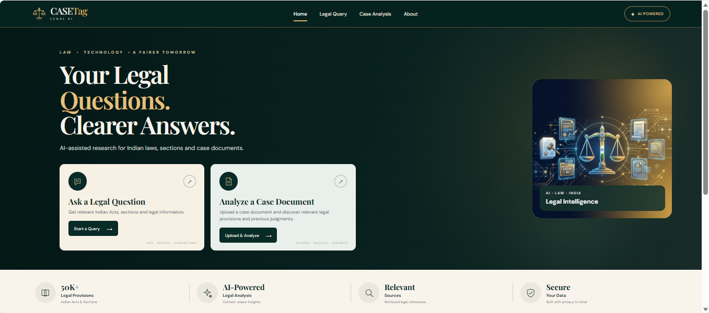
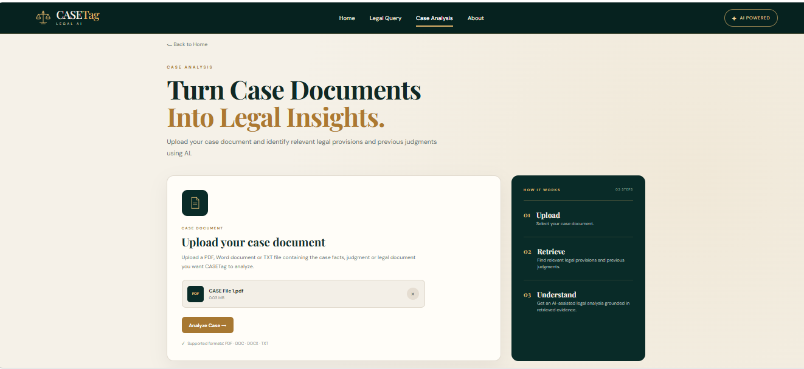
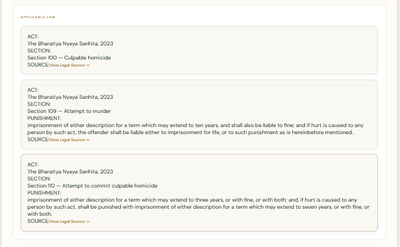
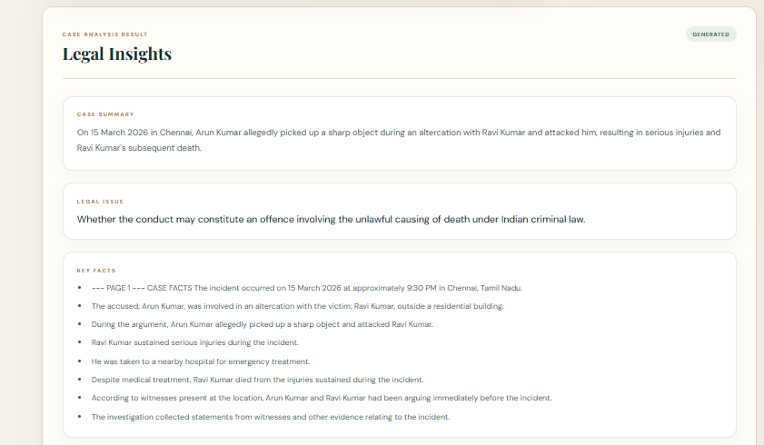
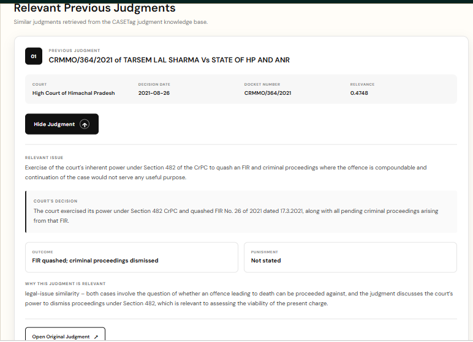
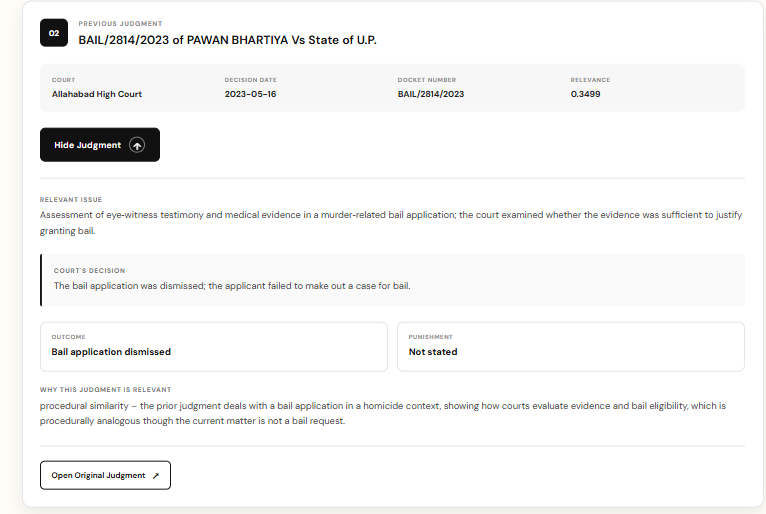
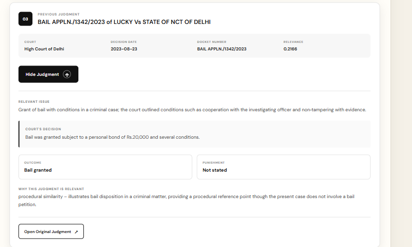
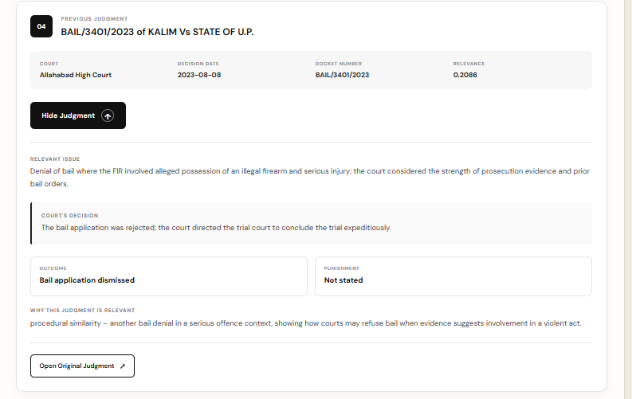
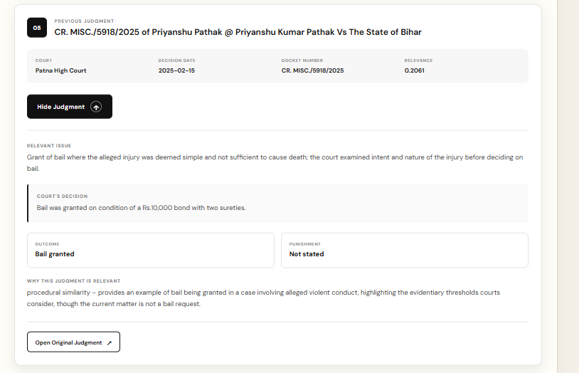

# CaseTag ⚖️
### RAG-Based Legal Provision and Precedent Retrieval with LLM-Based Explanation from Case Filings

CaseTag is an AI-powered legal research assistant designed to retrieve relevant Indian legal provisions and previous judgments using **Retrieval-Augmented Generation (RAG)**. It uses retrieved legal documents to generate contextual explanations that help users understand the legal provisions and precedents relevant to a case.

## 🎯 Project Overview

Finding relevant legal sections and previous judgments can require searching through large collections of legal documents. CaseTag aims to simplify this process by combining semantic retrieval with Large Language Model (LLM)-based explanations.

## ✨ Key Features

- **Legal Provision Retrieval:** Retrieve relevant acts and sections based on a user's case description.
- **Previous Judgment Retrieval:** Search for potentially relevant judgments from the available legal document collection.
- **RAG-Based Explanations:** Generate explanations grounded in retrieved legal documents.
- **Case Analysis:** Help users explore legal issues and supporting legal references.
- **Web Interface:** Interact with the legal research system through a React-based frontend.

## 🏗️ System Architecture

1. **User Input:** The user submits a legal query or case description.
2. **Document Processing:** Legal documents are prepared and split into manageable chunks.
3. **Embedding Generation:** Text embeddings represent the legal content semantically.
4. **Vector Search:** FAISS retrieves relevant document chunks.
5. **LLM-Based Explanation:** The language model uses retrieved context to formulate a response.
6. **Results:** The frontend displays the retrieved legal information and explanation.

## 🛠️ Technology Stack

| Component | Technologies |
|---|---|
| Backend | Python, FastAPI |
| Frontend | React, Vite, JavaScript, CSS |
| Retrieval | FAISS |
| Embeddings | Ollama, `nomic-embed-text` |
| Language Model | Groq API |
| Document Processing | Python PDF-processing tools |
| Configuration | Python environment variables |

## 📂 Project Structure

```text
CaseTag/
├── frontend-react/
│   └── frontend-react/
├── output/
│   ├── homepage.png
│   ├── case_analysis.png
│   ├── law_sections.png
│   └── retrieved_judgement_*.png
├── main.py
├── auth.py
├── rag.py
├── rag_case.py
├── embedding.py
├── pdf_processor.py
├── dataloader.py
├── prepare_data.py
├── build_judgment_vectorstore.py
├── retrieve_previous_judgments.py
├── get_complete_judgment.py
├── requirements.txt
└── .gitignore
```

## 🖥️ Application Screenshots

### Homepage


### Case Analysis


### Legal Sections


### Legal Insights


### Retrieved Judgment 1


### Retrieved Judgment 2


### Retrieved Judgment 3


### Retrieved Judgment 4


### Retrieved Judgment 5



## ⚙️ Setup and Installation

### Prerequisites

- Python
- Node.js and npm
- Ollama
- A Groq API key

### 1. Clone the repository

```bash
git clone https://github.com/Cibi-31/CaseTag.git
cd CaseTag
```

### 2. Create a Python virtual environment

```bash
python -m venv venv
```

Activate it on Windows:

```powershell
.\venv\Scripts\Activate.ps1
```

### 3. Install Python dependencies

```bash
pip install -r requirements.txt
```

### 4. Configure environment variables

Create a `.env` file in the project root:

```env
GROQ_API_KEY=your_groq_api_key
```

Never commit your `.env` file or expose API keys publicly.

### 5. Configure Ollama

Install Ollama and download the embedding model used by the project:

```bash
ollama pull nomic-embed-text
```

The application also requires the relevant FAISS vector store and legal document data. These resources are not included in this GitHub repository and must be prepared or supplied separately.

### 6. Start the backend

Check the application's FastAPI entry point and run the appropriate command. If `main.py` exposes the FastAPI application as `app`, use:

```bash
uvicorn main:app --reload
```

### 7. Start the frontend

Open a separate terminal:

```bash
cd frontend-react/frontend-react
npm install
npm run dev
```

## 🔐 Security and Responsible Use

- Store API keys in environment variables.
- Do not commit credentials, private case records, or confidential datasets.
- Treat generated explanations as research assistance, not a substitute for qualified legal advice.
- Verify cited legal provisions and judgments against authoritative sources before relying on them.

## 🚧 Limitations

The vector store and legal datasets are excluded from this repository because of their size. A complete local setup requires those resources and the required models and API configuration.

## 👩‍💻 Author

**Cibiksha V**

GitHub: [@Cibi-31](https://github.com/Cibi-31)

## 📄 Disclaimer

CaseTag is an AI-assisted legal research project for informational and educational purposes. Its outputs may be incomplete or inaccurate and should not be treated as definitive legal advice.
